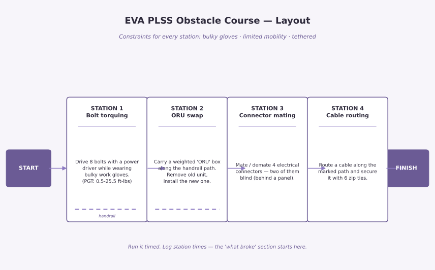

# EVA PLSS Obstacle Course

> A dry-land obstacle course replicating the most common tasks astronauts perform on EVAs while wearing a PLSS.

## What it does

*(In progress — research phase.)* The course puts a participant in PLSS-like constraints — bulky gloves, limited mobility, a tether — and runs them through stations modeled on the most common real EVA tasks:

- **Bolt torquing** — drive bolts with a power driver while wearing work gloves (the Pistol Grip Tool is the workhorse of ISS EVAs)
- **ORU swap** — carry a weighted "orbital replacement unit" box along a handrail path, remove the old unit, install the new one
- **Connector mating** — plug and unplug electrical connectors, some of them blind
- **Cable routing** — route a cable along a set path and secure it

*Demo — course layout (build from this):*

*Run video: coming after the physical build.*

## What it teaches

*(Draft — Malia to rewrite in her own words.)* ISS spacewalks are overwhelmingly maintenance, not assembly: remove-and-replace of failed units (batteries, pump modules, computers, cameras), driving bolts with the Pistol Grip Tool (0.5–25.5 ft-lbs; some bolts take 30–50 turns), mating and demating electrical and fluid connectors, and translating along the truss on handrails while tethered.

## How it was built

- **Tools used:** NASA EVA logs and spacewalk reports (web research)
- **Key decisions:** stations map 1:1 to the four most common EVA task categories; the constraints (gloves, tether) replicate the suit, not the vacuum — honest about what's simulated
- **Status:** research complete; course design and build are next

## What broke and what I learned

*(Draft — Malia to rewrite in her own words.)*

- **Assumption corrected:** I expected EVAs to be mostly assembly and construction. The logs show the ISS era is dominated by maintenance — swapping failed units and driving bolts. The course design changed to match reality, not the movie version.
- **Honesty check:** a dry-land course can't replicate microgravity or suit pressure. What it *can* replicate is the dexterity and mobility constraint — that's the part being tested.
